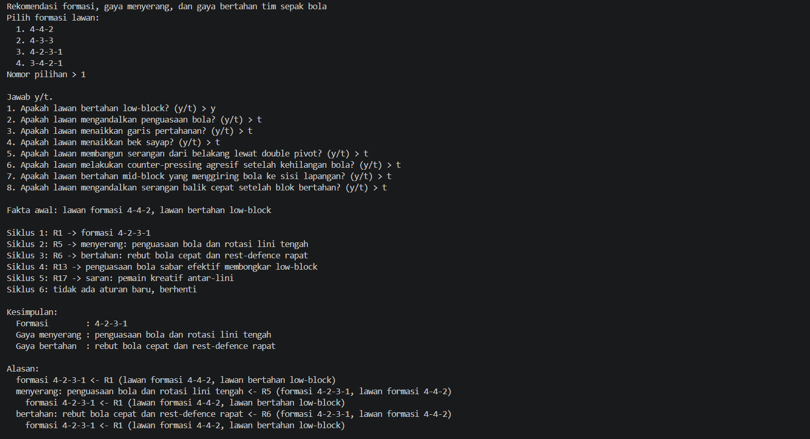
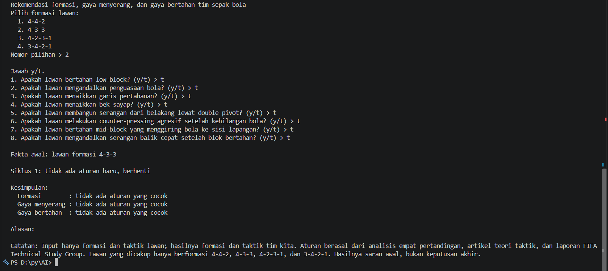
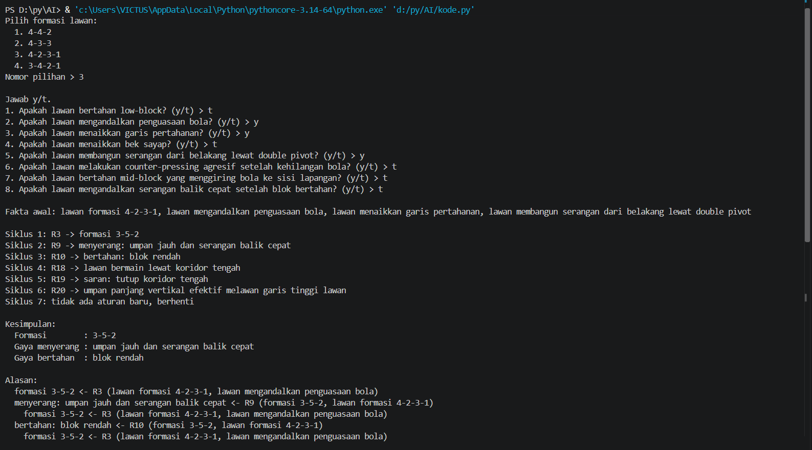

# Tugas 5 Kecerdasan Buatan - Sistem Pakar Sederhana

## 1. Identitas
- **Nama:** Muhammad Tegar Bijanta
- **NIM:** F1D02410081
- **Kelas:** 5-D

---

## 2. Topik dan Cara Menjalankan Program

**Topik:** Rekomendasi Formasi, Gaya Menyerang, dan Gaya Bertahan Tim Sepak Bola  
Program ini memberi saran awal formasi, gaya menyerang, dan gaya bertahan untuk tim kita berdasarkan formasi lawan dan ciri permainan lawan (misalnya bertahan low-block, menaikkan garis pertahanan, atau mengandalkan penguasaan bola). Aturan diambil dari taktik tim yang memenangkan pertandingan pada analisis taktik dan laporan FIFA Technical Study Group.

**Cara Menjalankan:**
- **Bahasa:** Python 3 (diuji pada Python 3.12)
- **Perintah:**
  Pastikan file `main.py` dan `based-rule.json` ada di satu folder yang sama, lalu jalankan perintah ini di terminal/CMD:
  ```bash
  python main.py based-rule.json
  ```
  Jika nama file aturan tidak ditulis, program memakai `based-rule.json` sebagai file bawaan.
  Pertama, pilih formasi lawan dengan mengetik nomor (1 sampai 4). Setelah itu jawab pertanyaan yang muncul dengan ketik `y` (ya) atau `t` (tidak).

---

## 3. Daftar Sumber dan Tabel Aturan

### Sumber
- **S1:** *Spain 1 Argentina 0: World Cup final tactical analysis*, Coaches' Voice, https://learning.coachesvoice.com/cv/spain-argentina-2026-world-cup-final-tactical-analysis/, diakses 13 Nov 2026.
- **S2:** *Barcelona 1-2 Real Madrid: Kylian Mbappé Strikes Twice as José Mourinho Claims Clásico Win*, Opta Analyst (Harry Carr, 25 Okt 2026), https://theanalyst.com/articles/barcelona-vs-real-madrid-el-clasico-live-stats-10-2026, diakses 13 Nov 2026.
- **S3:** *Inter Milan vs Como tactical analysis*, Goal.com, https://www.goal.com/en/news/inter-milan-vs-como-the-tactics-board-clinical-transitions-overwhelm-the-visitors-possession-game/blt7e8dc40c564e2e49, diakses 13 Nov 2026.
- **S4:** *AC Milan vs Inter Milan tactical analysis*, Goal.com, https://www.goal.com/id/berita/ac-milan-vs-inter-bedah-taktik-penguasaan-bola-versus-presisi-saat-pendekatan-efektif-milan-mengungguli-banyaknya-serangan-inter/bltc21b3fccda8dead3, diakses 13 Nov 2026.
- **S5:** *How to beat common pressing strategies*, Total Football Analysis (Cameron Meighan, 10 Feb 2020), https://totalfootballanalysis.com/article/how-to-beat-common-pressing-strategies-tactical-analysis-tactics, diakses 13 Nov 2026.
- **S6:** *Round review: Mid and low blocks and attacking transitions in the spotlight*, FIFA Training Centre (Technical Study Group), 26 Jun 2026, https://www.fifatrainingcentre.com/en/fifa-world-cup-2026/second-round-review-mid-blocks-and-attacking-transitions.php, diakses 13 Nov 2026.
- **S7:** *Technical Study Group hails competitive 48-team FIFA World Cup as goals and intensity rise*, FIFA, 30 Jun 2026, https://inside.fifa.com/talent-development/technical-study-group/news/tsg-technical-insights-world-cup-2026-otto-addo-gilberto-silva, diakses 13 Nov 2026.

### Tabel Aturan IF-THEN

| Aturan | IF | THEN | Sumber |
| :--- | :--- | :--- | :--- |
| **R1** | IF lawan formasi 4-4-2 AND lawan bertahan low-block | THEN formasi 4-2-3-1 | S1, S5 |
| **R2** | IF lawan formasi 4-3-3 AND lawan mengandalkan penguasaan bola AND lawan menaikkan garis pertahanan | THEN formasi 4-2-3-1 | S2 |
| **R3** | IF lawan formasi 4-2-3-1 AND lawan mengandalkan penguasaan bola | THEN formasi 3-5-2 | S3 |
| **R4** | IF lawan formasi 3-4-2-1 AND lawan menaikkan bek sayap | THEN formasi 3-4-2-1 | S4 |
| **R5** | IF formasi 4-2-3-1 AND lawan formasi 4-4-2 | THEN menyerang: penguasaan bola dan rotasi lini tengah | S1, S5 |
| **R6** | IF formasi 4-2-3-1 AND lawan formasi 4-4-2 | THEN bertahan: rebut bola cepat dan rest-defence rapat | S1, S7 |
| **R7** | IF formasi 4-2-3-1 AND lawan formasi 4-3-3 | THEN menyerang: transisi cepat dan serangan balik | S2 |
| **R8** | IF formasi 4-2-3-1 AND lawan formasi 4-3-3 | THEN bertahan: blok mid-to-low rapat | S2, S6 |
| **R9** | IF formasi 3-5-2 AND lawan formasi 4-2-3-1 | THEN menyerang: umpan jauh dan serangan balik cepat | S3 |
| **R10** | IF formasi 3-5-2 AND lawan formasi 4-2-3-1 | THEN bertahan: blok rendah | S3, S6 |
| **R11** | IF formasi 3-4-2-1 AND lawan formasi 3-4-2-1 | THEN menyerang: serangan balik vertikal | S4 |
| **R12** | IF formasi 3-4-2-1 AND lawan formasi 3-4-2-1 | THEN bertahan: blok mid-to-low asimetris dan counter-pressing | S4, S6 |
| **R13** | IF menyerang: penguasaan bola dan rotasi lini tengah AND lawan bertahan low-block | THEN penguasaan bola sabar efektif membongkar low-block | S1 |
| **R14** | IF menyerang: transisi cepat dan serangan balik AND lawan menaikkan garis pertahanan | THEN transisi cepat memanfaatkan ruang di belakang garis tinggi lawan | S2, S6 |
| **R15** | IF menyerang: serangan balik vertikal AND lawan menaikkan bek sayap | THEN serangan balik vertikal ke ruang di belakang bek sayap lawan | S4, S6 |
| **R16** | IF transisi cepat memanfaatkan ruang di belakang garis tinggi lawan OR serangan balik vertikal ke ruang di belakang bek sayap lawan | THEN saran: koordinasi bek tengah dan gelandang bertahan | S2, S4, S7 |
| **R17** | IF penguasaan bola sabar efektif membongkar low-block | THEN saran: pemain kreatif antar-lini | S1 |
| **R18** | IF lawan membangun serangan dari belakang lewat double pivot OR lawan mengandalkan penguasaan bola | THEN lawan bermain lewat koridor tengah | S3 |
| **R19** | IF lawan bermain lewat koridor tengah AND formasi 3-5-2 | THEN saran: tutup koridor tengah | S3 |
| **R20** | IF menyerang: umpan jauh dan serangan balik cepat AND lawan menaikkan garis pertahanan | THEN umpan panjang vertikal efektif melawan garis tinggi lawan | S3 |
| **R21** | IF lawan melakukan counter-pressing agresif setelah kehilangan bola | THEN saran: amankan umpan pertama | S6 |
| **R22** | IF lawan bertahan mid-block yang menggiring bola ke sisi lapangan | THEN saran: siapkan rencana di area sayap | S6 |
| **R23** | IF lawan mengandalkan serangan balik cepat setelah blok bertahan | THEN saran: jaga struktur bertahan saat menyerang | S6, S7 |

R1 sampai R4 menghasilkan formasi yang dipakai R5 sampai R12 untuk menentukan gaya menyerang dan gaya bertahan. Hasil R5 dipakai R13, lalu hasil R13 dipakai R17 (rantai R1 → R5 → R13 → R17). Rantai lain: R3 → R9 → R20, R18 → R19, serta R7 → R14 → R16 dan R11 → R15 → R16 (R16 memakai mode `atau`).

---

## 4. Metode yang Dipilih

**Metode:** Forward Chaining (FC)

**Alasan:**  
Pakai Forward Chaining karena saat menyusun strategi, kita mengamati kondisi lawan dulu (formasi lawan, apakah lawan bertahan low-block, menaikkan garis pertahanan, dan sebagainya), baru menelusuri formasi dan taktik yang cocok untuk tim kita. Program mengumpulkan fakta awal dari input user, mencocokkannya dengan aturan R1 sampai R23 secara berurutan, menambahkan hasilnya ke memori, lalu berhenti ketika tidak ada aturan baru yang terpicu. Aturan yang hasilnya sudah ada di memori tidak dijalankan lagi supaya program tidak berulang terus.

---

## 5. Tiga Kasus Uji dan Screenshot

| # | Input | Kesimpulan yang Diharapkan |
| :--- | :--- | :--- |
| 1 | Formasi lawan 4-4-2; jawaban "ya": lawan bertahan low-block | Formasi 4-2-3-1; menyerang: penguasaan bola dan rotasi lini tengah; bertahan: rebut bola cepat dan rest-defence rapat; saran: pemain kreatif antar-lini |
| 2 | Formasi lawan 4-4-2; semua pertanyaan dijawab "tidak" | tidak ada rekomendasi (kasus negatif) |
| 3 | Formasi lawan 4-2-3-1; jawaban "ya": lawan mengandalkan penguasaan bola, lawan menaikkan garis pertahanan, lawan membangun serangan dari belakang lewat double pivot | Formasi 3-5-2; menyerang: umpan jauh dan serangan balik cepat; bertahan: blok rendah; saran: tutup koridor tengah |

### Kasus 1


### Kasus 2 (Kasus Negatif)


### Kasus 3

---

## 6. Batas Keberlakuan

Aturan pada program ini diambil dari analisis taktik empat pertandingan (Coaches' Voice, Opta Analyst, dan Goal.com), satu artikel teori taktik (Total Football Analysis), serta laporan resmi FIFA Technical Study Group. Aturan hanya memakai formasi dan taktik tim pemenang, dan hanya mencakup lawan berformasi 4-4-2, 4-3-3, 4-2-3-1, dan 3-4-2-1. Formasi 3-5-2 hanya muncul sebagai hasil rekomendasi, bukan sebagai formasi lawan. Hasil dari program ini sifatnya hanya saran awal untuk membantu menyusun strategi, bukan keputusan akhir pelatih.

---

## 7. Penggunaan Alat Bantu AI

Menggunakan Claude dan Gemini untuk membantu menyusun aturan IF-THEN dari artikel sumber ke format JSON, memperbaiki struktur rule chaining, mencarikan sumber tambahan, dan merapikan format README.